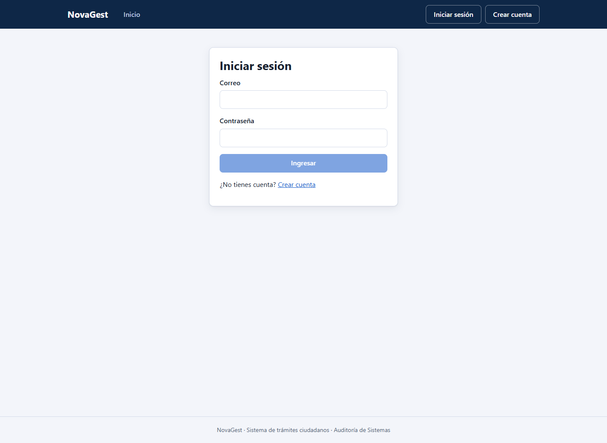
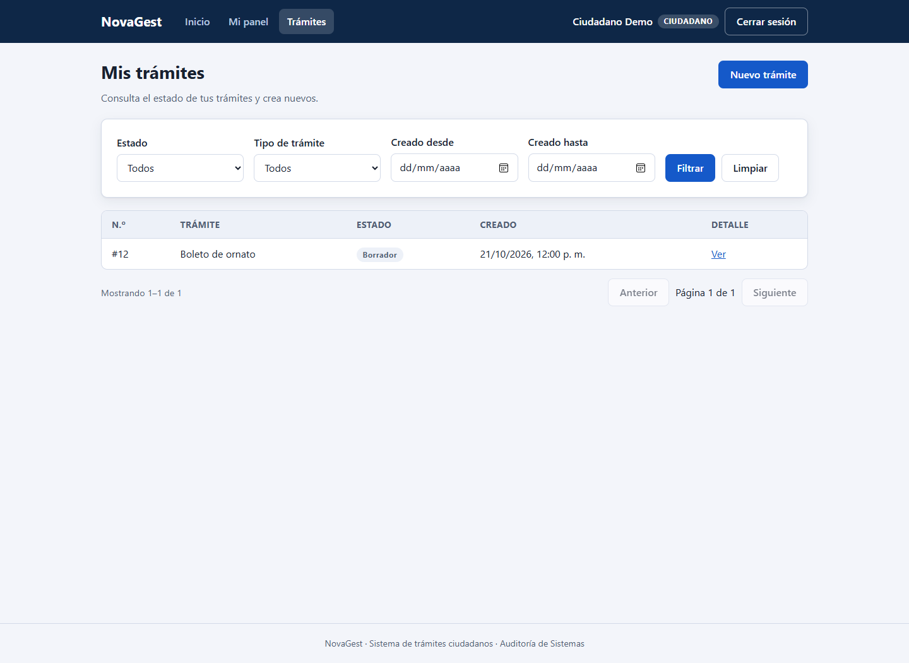
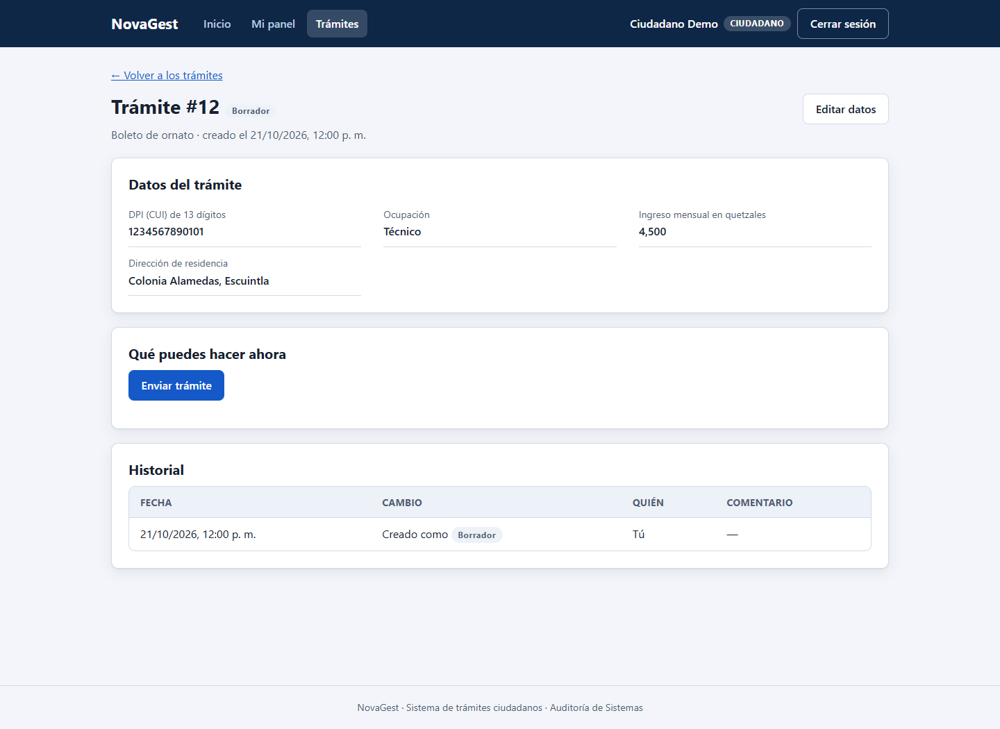
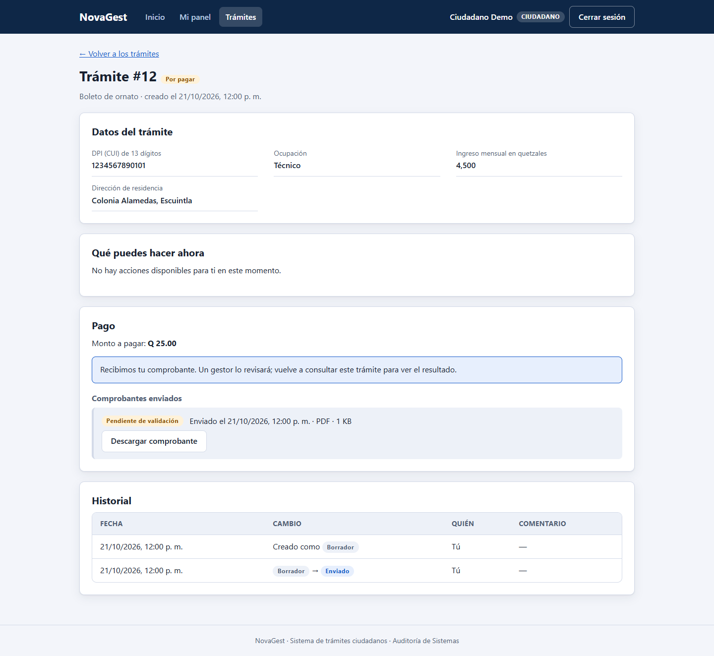
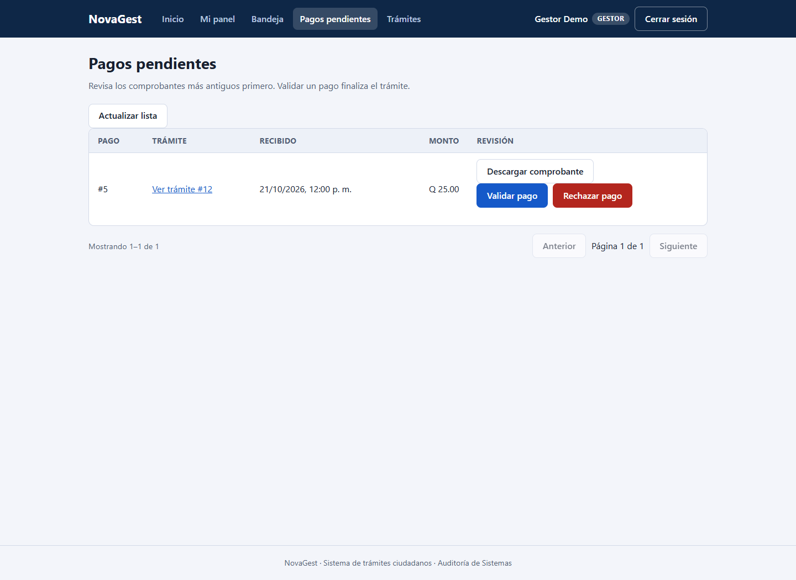
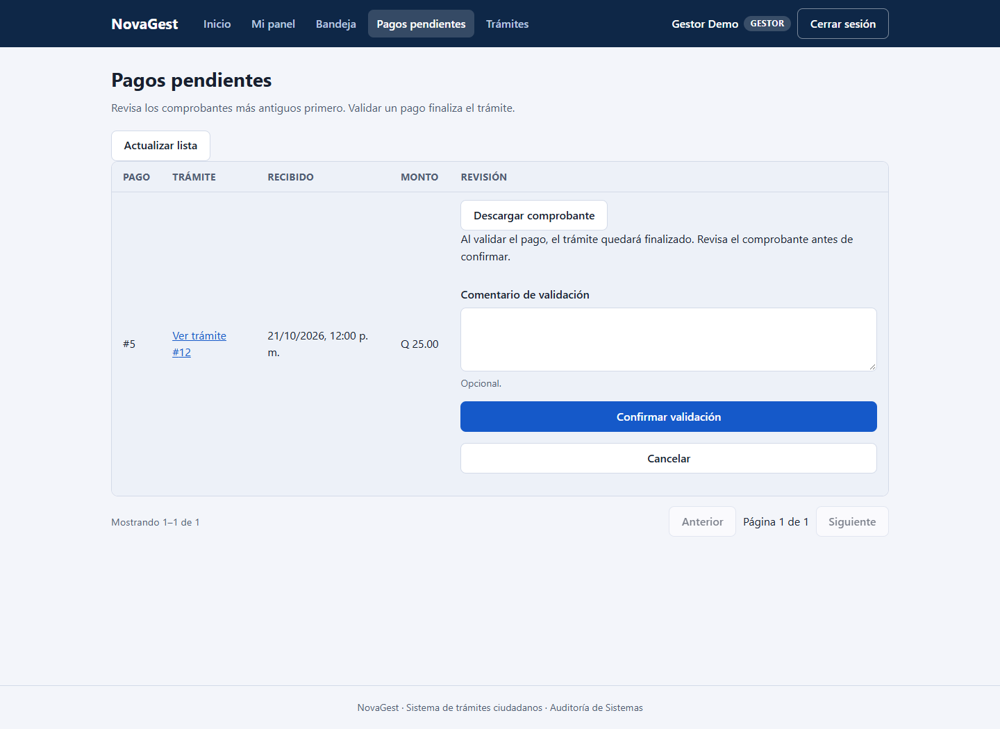
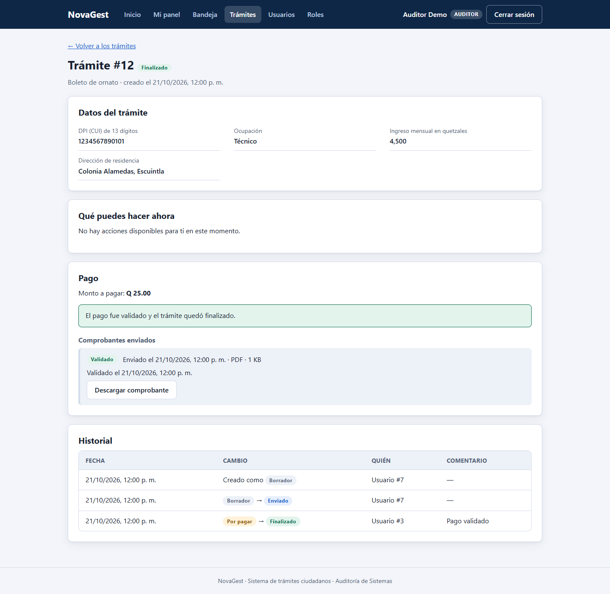
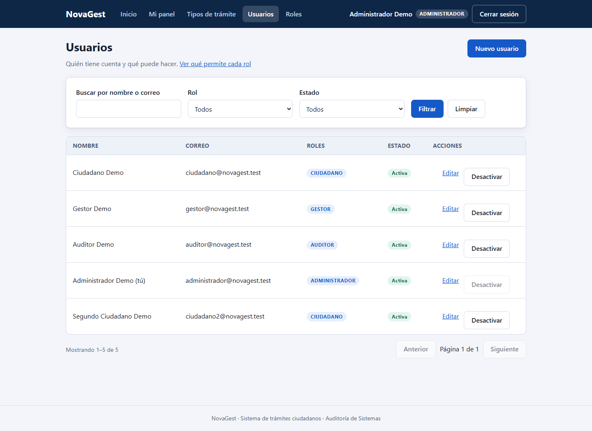
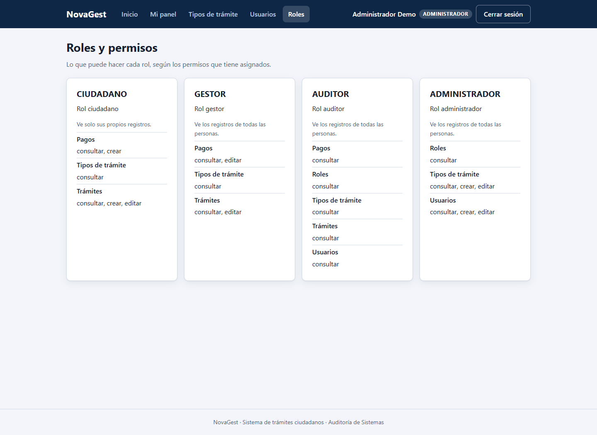

# Manual de usuario de NovaGest

Tarjeta 43. Complementa el esqueleto integrado en el PR #67 con las pantallas de las tarjetas 30, 32 y 33–36.
Las instrucciones corresponden al código de esta rama. Los permisos asignados a tu cuenta determinan las opciones visibles.

## Acceso y navegación

En local, prepara el proyecto siguiendo [Arranque y cuentas de demostración](../../README.md).
La API se ejecuta en http://localhost:8080 y el frontend en http://localhost:5173.
Abre el frontend y elige **Iniciar sesión**. Introduce correo y contraseña.
Tras entrar verás **Mi panel**, tus roles y las capacidades de tu cuenta.

El menú adapta sus enlaces a tus permisos. **Trámites** abre el listado; **Bandeja** aparece para el personal con alcance total.
Las tablas permiten cambiar de página; los filtros de trámites permanecen en la dirección del navegador.
Los errores aparecen junto al formulario o en un aviso; **Reintentar** vuelve a cargar cuando está disponible.

La sesión de acceso dura 15 minutos y se renueva automáticamente mientras sea posible.
Al recargar la pestaña se recupera la sesión mediante el token de renovación.
Usa **Cerrar sesión** antes de cambiar de cuenta en la misma pestaña.
No compartas tokens, contraseñas ni capturas de credenciales.
Tras cinco intentos fallidos consecutivos, la cuenta queda bloqueada 15 minutos.

### Usuarios de demostración (tarjeta 24)

Solo existen en el perfil dev. Todos usan la contraseña configurada en DEMO_PASSWORD.

| Rol | Correo |
| --- | --- |
| Ciudadano | ciudadano@novagest.test |
| Segundo ciudadano | ciudadano2@novagest.test |
| Gestor | gestor@novagest.test |
| Auditor | auditor@novagest.test |
| Administrador | administrador@novagest.test |

Ornato e IGSS se cargan por migración. Dev añade Constancia de residencia.
Cambiar DEMO_PASSWORD no cambia la contraseña de los usuarios ya creados.
No borres la base para resolver un bloqueo: espera 15 minutos o pide al administrador que desbloquee la cuenta.

### Estados del trámite

| Estado | Próximo paso |
| --- | --- |
| Borrador | El ciudadano completa, edita, envía o elimina su borrador |
| Enviado | El gestor lo toma para revisión |
| En revisión | El gestor observa, rechaza o aprueba para pago |
| Observado | El ciudadano corrige y envía la corrección |
| Por pagar | El ciudadano adjunta comprobante; el gestor lo resuelve |
| Finalizado | Pago validado; no hay más cambios de estado |
| Rechazado | Decisión definitiva, con motivo |

## 1. Ciudadano

### Registrarse

Abre **Registro** (/registro), completa nombre, correo y contraseña y envía el formulario.
El registro público crea una cuenta ciudadana. Para usar las cuentas demo, entra directamente en /ingresar.

### Crear, editar y enviar

1. Entra en **Trámites** (/tramites), donde solo aparecen tus registros.
2. Elige **Nuevo trámite** y selecciona un tipo.
3. Completa los campos de ese tipo. Los mensajes junto a cada campo indican errores de formato u obligatoriedad.
4. Guarda y revisa el detalle (`/tramites/<id>`). El trámite queda en **Borrador**.
5. Si hace falta corregir, usa **Editar**. Solo puedes editar en Borrador u Observado.
6. Pulsa **Enviar trámite**. El estado cambia a **Enviado** y queda a la espera de revisión.

En la lista puedes filtrar por estado, tipo y fechas. Abre **Ver** para consultar los datos y el historial.
El borrado de un borrador es lógico: conserva la evidencia. No se permite borrar trámites enviados.

### Corregir observaciones

Abre el trámite **Observado** y lee el comentario del gestor en el historial.
Edita los datos, guarda y pulsa **Enviar corrección**. Vuelve a **En revisión**.
Si no ves una acción, consulta el estado y el comentario; no intentes volver a enviar desde otro estado.

### Adjuntar y consultar el pago (tarjeta 34)

1. Espera a que el trámite esté **Por pagar**.
2. En su detalle, busca la sección **Pago** y elige un PDF, JPG o PNG real de hasta 5 MB.
3. Pulsa **Subir comprobante**. Verás **Pendiente** y el aviso de recepción.
4. Usa **Descargar comprobante** para revisar el archivo enviado.
5. Si fue rechazado, lee el motivo y adjunta uno nuevo. Solo puede haber un pago pendiente a la vez.
6. Tras la validación del gestor, verás el pago **Validado** y el trámite **Finalizado**.

No puedes validar pagos. Solo ves los comprobantes de tus propios trámites.
El historial del detalle muestra cada cambio, la fecha, el actor y su comentario.

### Ingresos y divisas

La API permite registrar ingresos propios y proyectarlos a otras monedas, pero esta versión todavía no tiene pantallas para ello.
Para una demostración técnica usa Swagger en dev: /api/ingresos, /api/ingresos/proyeccion y /api/divisas/monedas.
Un valor de respaldo se identifica como estimado. Ningún otro rol puede consultar tus ingresos.

## 2. Gestor

### Revisar la bandeja (tarjeta 35)

Abre **Bandeja** (/bandeja). Las colas son **Pendientes de atención**, **Por tomar**, **En revisión**, **Esperando pago** y **Observados**.
Los registros más antiguos aparecen primero. Los contadores indican cuántos hay en cada cola.
Abre un trámite y usa **Volver a la bandeja** para conservar la cola y la página.
Para filtrar por tipo y fechas, usa **Trámites**.

### Resolver una revisión

1. En **Por tomar**, abre un trámite Enviado y pulsa **Tomar para revisión**.
2. En **En revisión**, revisa los datos.
3. Para pedir correcciones, pulsa **Observar**, escribe un comentario y confirma.
4. Para denegar definitivamente, pulsa **Rechazar**, escribe el motivo y confirma.
5. Cuando cumpla los requisitos, pulsa **Aprobar y pasar a pago**.

Solo aparecen las transiciones que devuelve la API para tu cuenta y el estado actual.
Un cambio concurrente puede provocar un conflicto; actualiza el detalle y vuelve a comprobar el estado.

### Validar o rechazar un comprobante (tarjeta 36)

1. Abre **Pagos pendientes** (/pagos). La lista contiene solo pagos pendientes, ordenados por antigüedad y con paginación. También puedes entrar desde **Bandeja → Esperando pago** al detalle del trámite.
2. En **Pago → Comprobantes enviados**, descarga y revisa el comprobante pendiente.
3. Pulsa **Validar pago**. La confirmación explica que el trámite finalizará.
4. Añade un comentario opcional y pulsa **Confirmar validación**, o **Cancelar**.
5. Para rechazar, pulsa **Rechazar pago**, escribe un motivo de hasta 500 caracteres y pulsa **Confirmar rechazo**.
6. Al validar, se actualizan el pago, el estado del trámite, sus acciones y el historial.
7. Al rechazar, el trámite sigue **Por pagar** y el ciudadano puede enviar un nuevo comprobante.

No puedes resolver un pago que registraste tú, aunque tengas permiso de edición.
Un pago validado o rechazado ya no ofrece botones de decisión.
Si otro gestor ya lo resolvió, aparece un conflicto: usa **Actualizar estado del pago** antes de continuar.
Un error de permisos no significa que se haya guardado la decisión.

## 3. Auditor

Entra en **Trámites** o **Bandeja**, abre el detalle y consulta los datos, el historial y los comprobantes.
Puedes consultar **Usuarios** y **Roles** con sus permisos. Las opciones de escritura no aparecen.
No puedes editar trámites, validar pagos ni acceder a ingresos.

La pantalla de bitácora aún no está implementada en esta versión.
En dev puedes consultar GET /api/bitacora desde Swagger con tu cuenta: filtra por recurso, acción y fechas.
La bitácora registra el antes y después de las escrituras. Los datos personales de la vista del auditor pueden estar enmascarados.
No existe una opción para editar o borrar la bitácora.

## 4. Administrador

### Usuarios

En **Usuarios** (/usuarios), filtra y consulta las cuentas.
Usa **Nuevo usuario** para crear una cuenta y seleccionar sus roles.
Abre **Editar** para cambiar sus datos, activar/desactivar y asignar o quitar roles.
En el listado puedes activar o desactivar cuentas y desbloquear las bloqueadas. El borrado de usuarios se realiza mediante la API; esta pantalla no lo ofrece.
No puedes cambiar tus propios roles ni dejar al sistema sin administradores.

### Roles

**Roles** (/roles) muestra la descripción, alcance y permisos agrupados de cada rol.
Esta pantalla es de consulta. La creación o modificación de roles se realiza mediante la API con los permisos correspondientes.

### Tipos de trámite

En **Tipos de trámite** (/tipos), crea o edita un tipo con nombre, descripción, monto y campos.
Los campos admiten texto, número, fecha y sí/no; configura obligatoriedad y restricciones donde corresponda.
Ornato e IGSS comienzan con monto 0.00; el administrador debe definir el monto antes de una demostración de cobro con costo.
Los cambios afectan a los formularios de nuevos trámites. No elimines tipos usados en una demostración sin revisar su impacto.

## Problemas frecuentes

| Situación | Qué hacer |
| --- | --- |
| Credenciales inválidas | Revisa el correo y la contraseña. Si hubo cinco fallos, espera 15 minutos o solicita desbloqueo |
| Sesión vencida | Inicia sesión de nuevo; evita repetir la misma operación sin comprobar su resultado |
| No puedo editar | El ciudadano solo edita en Borrador u Observado |
| Comprobante rechazado por formato | Usa un PDF, JPG o PNG real de hasta 5 MB |
| Pago ya resuelto | Actualiza el estado; otra persona pudo tomar la decisión |
| No veo un botón o enlace | Comprueba los permisos y el estado con el administrador |
| No conecta con el servidor | Comprueba que la API esté activa; en local consulta /actuator/health |

El [guion de demostración](guion-demo.md) recorre el flujo con estas pantallas.

## Capturas por rol

Estas capturas muestran el frontend real ejecutado en navegador con una API simulada y datos ficticios. Ilustran los controles; no acreditan el backend desplegado ni un ensayo cronometrado.

### Acceso

### Ciudadano: trámites, borrador y comprobante

### Gestor: pendientes y confirmación

### Auditor: consulta sin acciones de escritura

### Administrador: usuarios y permisos

